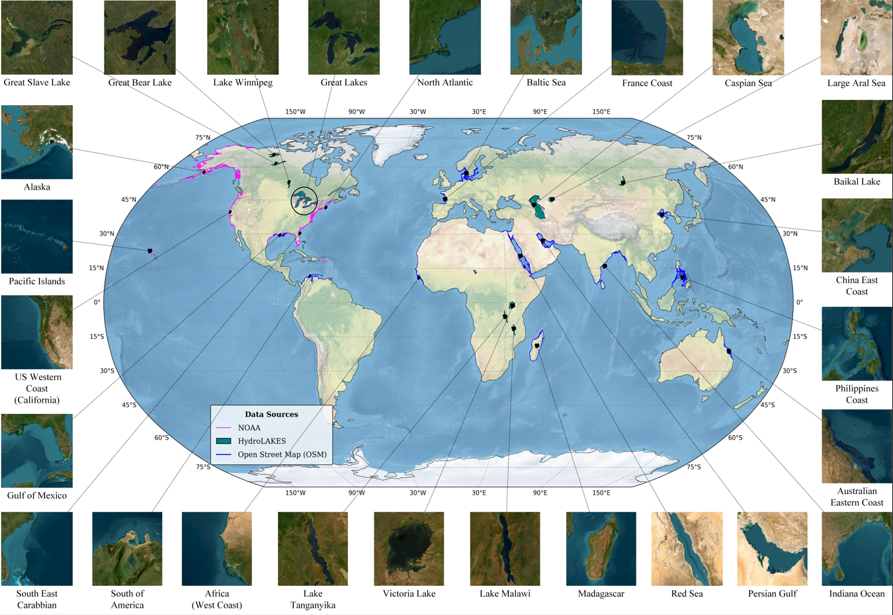
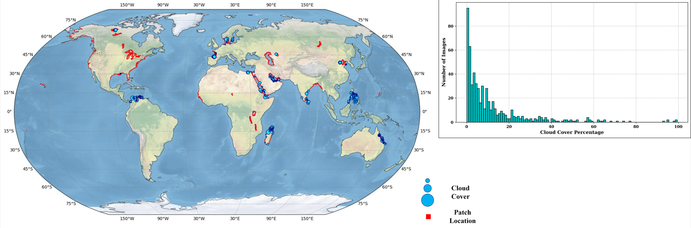
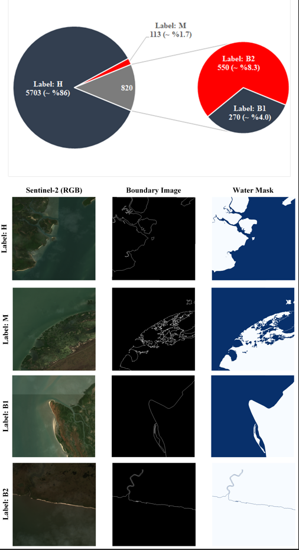
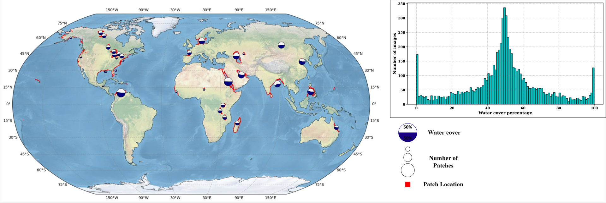
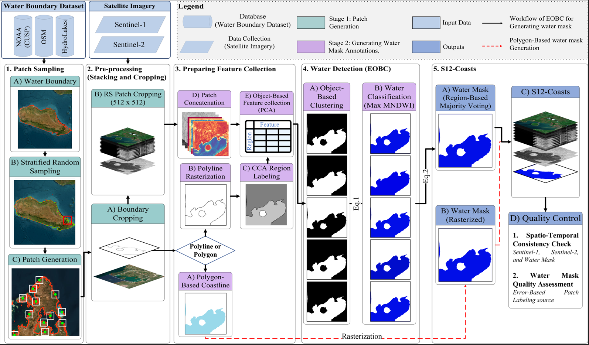
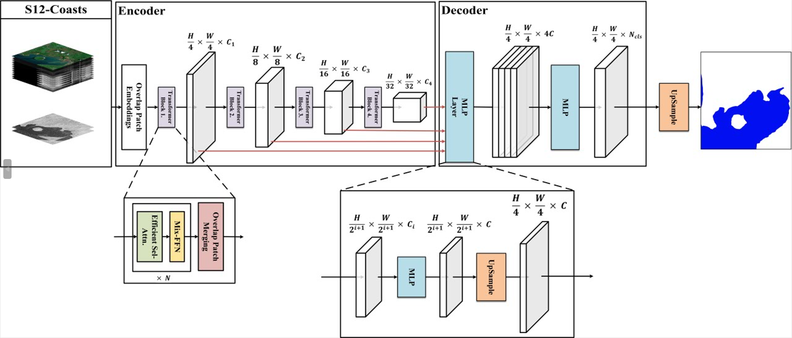
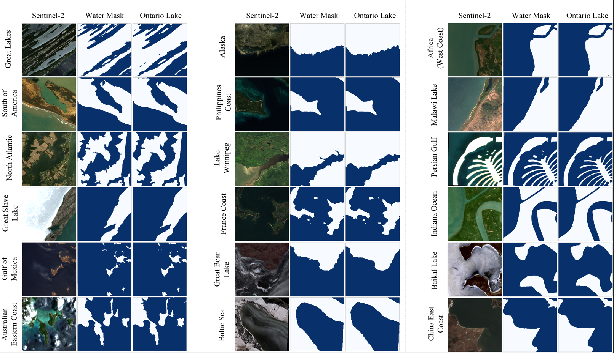

<div align="center">

# 🌊 S12-Coasts

### Automated Global Multimodal Benchmark for Water Body and Coastline Segmentation via Ensemble Object-Based Clustering

[](#)
[](https://doi.org/10.5281/zenodo.16934885)
[](https://creativecommons.org/licenses/by/4.0/)
[](LICENSE)
[](https://www.python.org/)
[](https://pytorch.org/)

**Soheil Zaghian · Seyed Ali Ahmadi · Ali Mohammadzadeh · Sadegh Jamali**


[📄 Paper](#) · [🗄️ Dataset (Zenodo)](#) · [📖 Docs](#) · [🐛 Issues](../../issues)

</div>

---
## 📌 Overview

**S12-Coasts** is a global, multimodal benchmark dataset for water body and coastline segmentation generated by the **Ensemble Object-Based Clustering (EOBC)** framework — an automated and unsupervised annotation pipeline integrating Sentinel-1 SAR and Sentinel-2 multispectral imagery with complementary water boundary datasets.

The current version of S12-Coasts comprises 6,637 paired Sentinel-1 and Sentinel-2 image patches (512×512 pixels) sampled from 27 diverse water body regions across a wide range of environmental and geographic conditions. Sentinel-1 SAR and Sentinel-2 multispectral imagery were spatially and temporally harmonized to ensure consistent multimodal representation. The SAR imagery contributes all-weather observational capability and sharp water–land boundary delineation, while the multispectral data provides spectral richness for discriminating diverse land-cover types, together enabling robust and accurate water body extraction across diverse environmental conditions. Furthermore, the corresponding water masks were generated by integrating three complementary water boundary datasets (i.e., HydroLakes, OSM, and NOAA CUSP), ensuring precise delineation of both primary coastlines and subsidiary water bodies. In several regions, patches were derived from two distinct boundary sources, yielding 33 region–source combinations in total. Together, these components produce a globally distributed benchmark that captures the variability and complexity of coastal and inland water systems across diverse geographic and climatic regions.

> **Key Contribution:** S12-Coasts addresses the scalability and reproducibility limitations of manually annotated benchmarks by providing a fully automated, globally distributed, and openly accessible resource for deep learning-based coastline segmentation.

<div align="center">



*Figure 1. Global distribution of S12-Coasts patches across 27 diverse water body regions.*

</div>

---

## 📊 Dataset at a Glance

| Property | Value |
|:---|:---|
| 🗺️ **Geographic Coverage** | 27 diverse water body regions worldwide |
| 🔢 **Total Patches** | 6,637 paired image patches |
| 📐 **Patch Size** | 512 × 512 pixels @ 10 m resolution |
| 🛰️ **Sensors** | Sentinel-1 SAR (VV, VH) + Sentinel-2 MSI (13 bands) |
| 📅 **Temporal Span** | 2018 – 2024 |
| 🏷️ **Region–Source Combinations** | 33 |
| 💧 **Water Boundary Sources** | OSM · NOAA CUSP · HydroLakes |
| ✅ **High Quality Patches** | > 86% |
| ☁️ **Cloud-Free Patches** | ~91% |

### Quality Label Distribution

| Label | Description | Share |
|:---|:---|:---:|
| **H** — High Quality | Fine detail, strong spatio-temporal alignment | > 86% |
| **B1** — Boundary Error L1 | Primary water only; omits fine features | ~4.0% |
| **B2** — Boundary Error L2 | Artefacts, disconnected boundaries, misalignment | ~8.3% |
| **M** — Model Error | Framework failure; excluded from final dataset | < 2% |

### Geographic Coverage by Boundary Source

| Source | Regions |
|:---|:---|
| **OSM** | Gulf of Mexico, South America, Baltic Sea, French Coast, West Africa, Madagascar, Red Sea, Persian Gulf, Indian Ocean, China East Coast, Philippine Coast, Australia East Coast |
| **NOAA CUSP** | Great Lakes, Alaska, Gulf of Mexico, Western Coast, Southeast Caribbean, Pacific Islands, North Atlantic |
| **HydroLakes** | 14 largest lakes — Russia, Canada, USA, Uzbekistan, Chad, Uganda, Malawi, DR Congo |

---

## 🏗️ EOBC Framework

The S12-Coasts dataset is generated through a two-stage automated pipeline:




## 📋 Pseudo-Code

### Algorithm 1 — Stage 1: Patch Generation and Sampling

```
ALGORITHM: Patch Generation and Sampling
──────────────────────────────────────────────────────────────
INPUT:  Water boundary vectors B (OSM / NOAA CUSP / HydroLakes)
        Sentinel-1 imagery S1 (VV, VH)
        Sentinel-2 imagery S2 (13 bands)
        Number of patches n
OUTPUT: Paired patches {S1_patch, S2_patch, boundary_patch}

Procedure PatchSampling(B, S1, S2, n):

  ── Step 1: Stratified Random Sampling ──
  centroids ← StratifiedRandomSampling(B, n)
    // Centroid points distributed evenly along water boundary vectors
    // to ensure broad spatial coverage and avoid inter-patch overlap

  ── Step 2: Patch Boundary Generation ──
  for each centroid c in centroids do
    patch_bounds[c] ← CentroidBasedPatchBoundary(c, patch_size=512)
      // Square polygon: 5,120 m × 5,120 m → 512 × 512 px at 10 m
  end for

  ── Step 3: Pre-Processing and Patch Extraction ──
  for each patch p in patch_bounds do

    // 3a — Crop water boundary vector to patch extent
    boundary_patch[p] ← CropWaterBoundary(B, p)

    // 3b — Retrieve and pre-process Sentinel-2
    S2_scene ← GEE_Retrieve("COPERNICUS/S2_SR_HARMONIZED", p)
    if CloudCover(S2_scene) > 30% then
      discard patch p
      continue
    end if
    S2_patch[p] ← Clip(S2_scene, p)

    // 3c — Retrieve and pre-process Sentinel-1
    S1_scene ← GEE_Retrieve("COPERNICUS/S1_GRD", p)
    S1_patch[p] ← Clip(ThermalNoiseRemoval(
                        RadiometricCalibration(
                        TerrainCorrection(S1_scene))), p)
    S1_patch[p] ← Resample(S1_patch[p], target_resolution=10m)

    // 3d — Temporal synchronisation check
    if |AcquisitionDate(S1_patch[p]) - AcquisitionDate(S2_patch[p])| > 1 day then
      discard patch p
      continue
    end if

    // 3e — Accept patch
    EO_components[p] ← {S1_patch[p], S2_patch[p]}

  end for

  return boundary_patch, EO_components

End Procedure
──────────────────────────────────────────────────────────────
```

### Algorithm 2 — Stage 2: Water Mask Generation (EOBC)

```
ALGORITHM: Ensemble Object-Based Clustering (EOBC)
──────────────────────────────────────────────────────────────
INPUT:  boundary_patch, EO_components {S1_patch, S2_patch}
OUTPUT: Binary water mask M ∈ {0,1}^(512×512) per patch
        Quality label q ∈ {H, B1, B2, M} per patch

Procedure EOBC(boundary_patch, EO_components):

  for each patch p in EO_components do

    type ← IdentifyBoundaryType(boundary_patch[p])
      // type ∈ {Polygon, Polyline}

    ══ PATHWAY A: Polygon-based (HydroLakes) ══════════════════
    if type == Polygon then
      M[p] ← Rasterise(boundary_patch[p])
        // Interior → water (1), Exterior → non-water (0)
      goto QualityControl

    ══ PATHWAY B: Polyline-based (OSM / NOAA) ═════════════════
    else if type == Polyline then

      ── Step 1: Boundary Rasterisation ──
      raster[p] ← RasteriseBoundary(boundary_patch[p])
        // Coastline pixels = 1, all others = 0

      ── Step 2: Connected Component Analysis ──
      L[p] ← ConnectedComponentAnalysis(raster[p])
        // L[p] = {R_1, R_2, ..., R_N} — labelled regions

      ── Step 3: Object-Based Feature Extraction ──
      for each labelled region R_l in L[p] do

        // Spectral indices from S2_patch[p]:
        MNDWI ← (Green − SWIR) / (Green + SWIR)
        NDVI  ← (NIR − Red)    / (NIR + Red)
        AWEI  ← Blue + 2.5×Green − 1.5×(NIR+SWIR1) − 0.25×SWIR2
        WRI   ← (Green + Red)  / (NIR + SWIR)
        NDPI  ← (NIR − Green)  / (NIR + Green)

        // SAR features from S1_patch[p]:
        SAR_features ← {VV, VH}

        // Per-region statistics:
        obj_feats[R_l] ← {Mean, Median, Std} of
                          {MNDWI, NDVI, AWEI, WRI, NDPI, VV, VH}
                          over all pixels in R_l
      end for

      // PCA dimensionality reduction → top-5 components
      F[p] ← PCAExtraction(obj_feats, n_components=5)

      ── Step 4: Ensemble Object-Based Clustering ──
      for each algorithm A_m in
          {K-means, Agglomerative, GMM,
           Affinity Propagation, Fuzzy C-means} do

        // Grid search hyperparameter optimisation
        // Cluster count fixed at K=2 (water / non-water)
        clusters_m ← Cluster(F[p], algorithm=A_m, K=2)

        // Evaluate clustering quality (no ground truth):
        score_m ← {SilhouetteScore, DaviesBouldinIndex,
                   CalinskiHarabaszIndex}(clusters_m)

        // Water class identification (Eq. 1):
        //   c^m(C_j^m) = 1 if j = argmax_j μ_MNDWI(C_j^m), else 0
        for each cluster C_j in clusters_m do
          C_water_m[p] ← argmax_j { μ_MNDWI(C_j^m) }
        end for

      end for

      ── Step 5: Region-Based Majority Voting ──
      // Final label per labelled region R_l (Eq. 2):
      //   ĉ(R_l) = 1 if Σ_m c^m(R_l) > M/2, else 0
      //   where M = 5 (total clustering algorithms)
      for each labelled region R_l in L[p] do
        votes_water    ← Σ_m [ c^m(R_l) == water ]
        votes_nonwater ← Σ_m [ c^m(R_l) == non-water ]
        if votes_water > votes_nonwater then
          M[p][R_l] ← 1  // water
        else
          M[p][R_l] ← 0  // non-water
        end if
      end for

    end if

    ══ QUALITY CONTROL ════════════════════════════════════════
    QualityControl:
      // Level 1: Spatio-temporal alignment assessment
      //          {S1_patch, S2_patch, M[p]}
      // Level 2: Water mask quality vs. S2 and
      //          high-resolution reference imagery

      q[p] ← AssignQualityLabel(M[p], S1_patch[p], S2_patch[p])
        // q[p] ∈ {H, B1, B2, M}

      if q[p] == M then
        exclude patch p from final dataset
      end if

  end for

  return M, q

End Procedure
──────────────────────────────────────────────────────────────
OUTPUT → S12-Coasts: 6,637 patches · 33 region-source combinations
         Quality: >86% H · ~12% B1/B2 · <2% M (excluded)
──────────────────────────────────────────────────────────────
```

---

## 🚀 Getting Started

### Installation

```bash
## 🚀 Getting Started

### 1. Clone the Repository

```bash
git clone https://github.com/SoheilZaghian/S12-Coasts.git
cd S12-Coasts
```

### 2. Set Up the Environment

```bash
# Create and activate a virtual environment
python -m venv s12coasts_env
source s12coasts_env/bin/activate      # Linux / Mac
s12coasts_env\Scripts\activate         # Windows
```

### 3. Install Dependencies

> ⚠️ **GDAL must be installed before other packages.**  
> We strongly recommend using conda for GDAL to avoid platform-specific build issues:

```bash
# Option A — conda (recommended)
conda install -c conda-forge gdal
pip install -r requirements.txt

# Option B — pip only (Linux)
pip install gdal
pip install -r requirements.txt

### 4. Authenticate Google Earth Engine (Stage 1 only)

```bash
earthengine authenticate
```

> This is required only for Stage 1 (patch generation).  
> Follow the browser prompt to authorise access with your Google account.  
> Once authenticated, GEE credentials are cached locally for future runs.

### 5. Install as a Package (optional)

```bash
# Editable install — for development or direct import
pip install -e .

# Then use anywhere in Python
from s12coasts.eobc import EOBCPipeline
from s12coasts.patch_generation import PatchProcessor
```
### 6. Verify Installation

```bash
# Run the test suite
pytest tests/ -v

# Or check the CLI entry points
s12coasts-patch --help
s12coasts-eobc  --help
```

### Requirements

```
# S12-Coasts Requirements
# =======================
# Install all:      pip install -r requirements.txt
# Core only:        pip install s12coasts
# With GEE:         pip install "s12coasts[gee]"
# With GDAL:        pip install "s12coasts[gdal]"
# With SegFormer:   pip install "s12coasts[segformer]"
# Full:             pip install "s12coasts[all]"

# ── Core (always required) ─────────────────────────────────────────────────
numpy>=1.24.0
pandas>=2.0.0
scipy>=1.11.0
matplotlib>=3.7.0
seaborn>=0.12.0
tqdm>=4.65.0
pyyaml>=6.0
scikit-learn>=1.3.0
scikit-image>=0.21.0
scikit-fuzzy>=0.4.2
geopandas>=0.13.0
shapely>=2.0.0

# ── Stage 1 — Patch Generation (GEE) ──────────────────────────────────────
earthengine-api>=0.1.350
geemap>=0.27.0

# ── Stage 2 — EOBC (GDAL — conda recommended) ─────────────────────────────
# conda install -c conda-forge gdal
GDAL>=3.6.0
rasterio>=1.3.0

# ── Stage 3 — SegFormer Baseline ──────────────────────────────────────────
torch>=2.0.0
torchvision>=0.15.0
transformers>=4.30.0

# ── Development & Testing ──────────────────────────────────────────────────
pytest>=7.4.0
pytest-cov>=4.1.0
black>=23.0.0
isort>=5.12.0
flake8>=6.0.0
mypy>=1.5.0

```

---

## 📁 Repository Structure

```
S12-Coasts/
│
├── 📂 data/
│   ├── __init__.py    
│   ├── boundary_vectors/           # OSM, NOAA, HydroLakes vectors
│   ├── patch_metadata/             # Patch coordinates and quality labels
│   └── quality_control/            # QC results and labels
│
├── 📂 s12coasts/
│   ├── __init__.py   
│   ├── 📂 patch_generation/
│   │   ├── __init__.py
│   │   ├── sampling.py             ← PointGenerator, ShapefileProcessor
│   │   ├── boundary.py             ← PatchBoundaryCreator
│   │   ├── processor.py            ← PatchProcessor
│   │   └── filters.py              ← cloud/temporal filtering
│   │
│   ├── 📂 eobc/
│   │   ├── __init__.py
│   │   ├── features.py             ← FeatureExtractor
│   │   ├── optimiser.py            ← ClusteringOptimiser
│   │   ├── clusterer.py            ← EOBCClusterer
│   │   ├── pipeline.py             ← EOBCPipeline
│   │   └── algorithms.py           ← algorithm registry + param grids
│   ├── 📂 io/
│   │   ├── __init__.py
│   │   ├── geotiff.py              ← GeoTIFFExporter
│   │   └── metadata.py             ← MetadataManager
│   └── 📂 utils/
│   │   ├── __init__.py
│   │   ├── config.py               ← load_config(), DEFAULT_CONFIG
│   │   └── visualise.py            ← visualise_patch()
│   │
│   ├── 📂 quality_control/
│   │   ├── visual_inspection.py    # QC assessment tools
│   │   └── labelling.py            # Quality label assignment (H/B1/B2/M)
│   │
│   └── 📂 segmentation/
│       ├── __init__.py                
│       ├── dataset.py                
│       ├── model.py             
│       ├── train.py                
│       ├── evaluate.py             
│       ├── visualise.py
│       └── cli.py              
│
├── 📂 notebooks/
│   ├── 01_patch_generation.ipynb
│   ├── 02_eobc_water_mask.ipynb
│   ├── 03_segformer_training.ipynb
│   ├── 04_lori_cv_evaluation.ipynb
│   └── 05_qualitative_assessment.ipynb
│
├── 📂 configs/
│   ├── patch_config.yaml
│   ├── eobc_config.yaml
│   └── segformer_config.yaml
├── 📂 tests/
│   ├── test_features.py
│   ├── test_clustering.py
│   └── test_pipeline.py
│
├── setup.py                        ← classic install
├── pyproject.toml                  ← modern PEP 517/518 build config
├── setup.cfg                       ← metadata + optional deps
├── MANIFEST.in                     ← include non-Python files
├── requirements.txt                ← development dependencies
├── LICENSE
└── README.md
```

---

## 🔬 Running the Pipeline

### Stage 1 — Patch Generation

```bash
# Via CLI (recommended)
s12coasts-patch --config configs/patch_config.yaml

# Override specific options
s12coasts-patch --region Madagascar_line --n_points 300 --start_date 2018-01-01
```

```python
# Via Python API
from s12coasts.patch_generation import (
    ShapefileProcessor,
    PointGenerator,
    PatchBoundaryCreator,
    PatchProcessor,
)
from s12coasts.utils.config import load_config
from shapely.ops import unary_union
import geemap, ee

ee.Initialize()
config = load_config("configs/patch_config.yaml", config_type="patch")

# Step 1: Load water boundary shapefile
processor = ShapefileProcessor(
    directory_path=config["directory_path"],
    zip_files_directory=config["zip_files_directory"],
)
coast_gdf = processor.process_region(config["region_name"])

# Step 2: Generate centroid points via stratified random sampling
line_union   = unary_union(coast_gdf.geometry)
points       = PointGenerator.generate_points(line_union, num_points=config["n_points"])
centroid_gdf = PointGenerator.to_geodataframe(points)
centroid_ee  = geemap.gdf_to_ee(centroid_gdf)

# Step 3: Create 512×512 px square patch boundaries
patch_creator     = PatchBoundaryCreator(patch_size_m=config["patch_size_m"])
buffered_polygons = centroid_ee.map(patch_creator.create_patch_boundary)

# Step 4: Retrieve S1/S2 imagery and submit GEE export tasks
patch_processor = PatchProcessor(buffered_polygons, coast_gdf, config)
metadata_df     = patch_processor.process_all_patches()
# → Monitor exports: https://code.earthengine.google.com/tasks
```

---

### Stage 2 — Water Mask Generation (EOBC)

```bash
# Via CLI (recommended)
s12coasts-eobc --config configs/eobc_config.yaml

# Override specific options
s12coasts-eobc --input_dir data/patches/Huron_Lake \
               --output_dir outputs/masks/Huron_Lake \
               --region Huron_Lake --visualise
```

```python
# Via Python API — full pipeline
from s12coasts.eobc import EOBCPipeline
from s12coasts.utils.config import load_config

config   = load_config("configs/eobc_config.yaml", config_type="eobc")
pipeline = EOBCPipeline(config)
pipeline.run()
# → Outputs: outputs/masks//S1/  S2/  gt/  data_information.csv
```

```python
# Via Python API — individual components
from s12coasts.eobc import (
    FeatureExtractor,
    ClusteringOptimiser,
    EOBCClusterer,
    build_algorithm_registry,
)
from skimage.measure import label
from skimage.morphology import disk, dilation

# Step 1: Connected component analysis → labelled regions
boundary    = image_array[20]                          # band 20 = water boundary
dilated     = dilation(boundary, disk(1))
label_image = label(~dilated.astype(bool), connectivity=1)

# Step 2: Object-based feature extraction + PCA
# Features: MNDWI, NDVI, AWEI, WRI, NDPI (S2) · VV, VH (S1)
# Statistics: median, variance, mean per region → top-5 PCA components
extractor    = FeatureExtractor(feature_bands=[13,14,15,16,17,18,19], n_pca_components=5)
pca_features = extractor.extract(image_array, label_image)

# Step 3: Grid-search hyperparameter optimisation (no ground truth required)
optimiser          = ClusteringOptimiser(pca_features, patch_id=0)
results_df, best_params_df = optimiser.run()

# Step 4: Ensemble Object-Based Clustering (5 algorithms)
# K-Means · Agglomerative · Bayesian GMM · Affinity Propagation · Fuzzy C-Means
clusterer = EOBCClusterer(build_algorithm_registry(), best_params_df, pca_features)
clusterer.cluster()

# Step 5: Water class identification via max MNDWI [Eq. 1]
#         + Region-based majority voting [Eq. 2] → final binary water mask
mndwi_image = image_array[13]
water_mask  = clusterer.majority_vote(label_image, mndwi_image)
```
---

## 🤖 Segmentation: SegFormer Baseline

A SegFormer model with MiT-B1 backbone (~14M parameters) was used as a **proof-of-concept baseline** to evaluate the applicability of S12-Coasts under the **Leave-One-Region-In Cross-Validation (LORI-CV)** framework.


> **LORI-CV:** The model is trained on patches from one region–source combination and evaluated on all remaining combinations. This procedure is repeated for all 33 combinations, enabling simultaneous assessment of model transferability and benchmark representativeness.

```python
```bash
# Train on a single region
s12coasts-segment --mode train \
    --dataset_root outputs/masks/ \
    --region Ontario_Lake \
    --n_epochs 50

# Full LORI-CV evaluation across all 33 region–source combinations
s12coasts-segment --mode lori_cv \
    --dataset_root outputs/masks/ \
    --model_dir outputs/models/ \
    --results_dir outputs/results/ \
    --regions Ontario_Lake Baltic_Sea Great_Lakes Alaska

# Evaluate a specific train → test pair
s12coasts-segment --mode evaluate \
    --train_region Ontario_Lake \
    --test_region Baltic_Sea
```

```python
# Via Python API
from s12coasts.segmentation import (
    S12CoastsDataset,
    load_segformer,
    train_region,
    LORICVEvaluator,
)

# Step 1: Build dataset and DataLoaders
ds = S12CoastsDataset(
    root="outputs/masks/",
    region_name="Ontario_Lake",
    quality_labels=["H"],       # High Quality patches only
    batch_size=8,
)
ds.train_val_split(split_ratio=0.7)
ds.create_samplers()
ds.create_dataloaders()
train_loader, val_loader = ds.get_dataloaders()

# Step 2: Load SegFormer baseline (MiT-B1, ~14M parameters)
model = load_segformer(backbone="nvidia/mit-b1")

# Step 3: Train on a single region
history = train_region(
    model=model,
    train_loader=train_loader,
    val_loader=val_loader,
    region_name="Ontario_Lake",
    save_dir="outputs/models/",
    n_epochs=50,
    lr=6e-5,
)
print(f"Best IoU: {history['best_iou']:.4f} at epoch {history['best_epoch']}")

# Step 4: Full LORI-CV evaluation
evaluator = LORICVEvaluator(
    dataset_root="outputs/masks/",
    model_dir="outputs/models/",
    results_dir="outputs/results/",
    regions=["Ontario_Lake", "Baltic_Sea", "Great_Lakes", "Alaska"],
    n_epochs=50,
)
summary_df = evaluator.run()

# Step 5: Pivot results into a train × test metric matrix
iou_matrix = evaluator.pivot_metric("IoU")
oa_matrix  = evaluator.pivot_metric("OA")
```
### S12Coasts And Segmentaion Results 



### Evaluation Metrics

| Metric | Formula | Role |
|:---|:---|:---|
| **OA** | $(TP+TN)/(TP+TN+FP+FN)$ | General accuracy — susceptible to class imbalance |
| **IoU** | $TP/(TP+FP+FN)$ | Most discriminative — spatial overlap |
| **F-score** | $2 \cdot TP/(2 \cdot TP+FP+FN)$ | Balances Precision and Recall |
| **Precision** | $TP/(TP+FP)$ | Avoidance of false positives |
| **Recall** | $TP/(TP+FN)$ | Detection of true water pixels |

### Baseline Results

| Configuration | Mean OA | Mean IoU |
|:---|:---:|:---:|
| Overall (all 33 combinations) | **0.91** | **0.82** |
| Best performing regions | 0.95 | 0.94 |
| Most challenging regions (Caspian Sea, Large Aral Sea) | 0.67 | 0.41 |

> **Note:** Reduced performance in the Caspian Sea and Large Aral Sea reflects temporal obsolescence of HydroLakes-derived reference masks rather than true model failure — confirmed by qualitative visual inspection.

---

## 🗄️ Dataset Access

The S12-Coasts dataset is openly accessible via Zenodo:

[](https://doi.org/10.5281/zenodo.16934885)

```
S12-Coasts/
├── Region_1/
│   ├── sentinel1/          # sentinel1 - VV, VH polarisation (TIF)
│   ├── sentinel2/          # sentinel2 - 13 multispectral bands (TIF)
│   └── gt/                 # Binary water masks (TIF)
├── Region_2/
│   ├── sentinel1/          # sentinel1 - VV, VH polarisation (TIF)
│   ├── sentinel2/          # sentinel2 - 13 multispectral bands (TIF)
│   └── gt/                 # Binary water masks (TIF)
├── Region_3/
│   ├── sentinel1/          # sentinel1 - VV, VH polarisation (TIF)
│   ├── sentinel2/          # sentinel2 - 13 multispectral bands (TIF)
│   └── gt/                 # Binary water masks (TIF)
.
.
.
├── metadata/
│   ├── Data_information.csv      # Region, source, date, coordinates, H / B1 / B2 / M per patch
└── 
```

---

## 📈 Citation

If you use S12-Coasts in your research, please cite:

Zaghian, S., Mohammadzadeh, A., Ahmadi, S. A., & Jamali, S. (2025). S12-Coasts (V 1.0) [Data set]. Zenodo. [https://doi.org/10.5281/zenodo.16934885](https://doi.org/10.5281/zenodo.16934885)

```bibtex

```

---

## 👥 Contributors

| Name | Role |
|:---|:---|
| **Soheil Zaghian** | Conceptualization, Methodology, dataset generation, Software,  Validation, Formal Analysis, Visualization|
| **Seyed Ali Ahmadi** | Conceptualization, Methodology, Formal Analysis, dataset generation |
| **Ali Mohammadzadeh** | Supervision, Conceptualization |
| **Sadegh Jamali** | Supervision |

Contributions are welcome — please open an [issue](../../issues) or submit a pull request.

---

## 🙏 Acknowledgements

- **ESA / Copernicus Programme** for Sentinel-1 and Sentinel-2 imagery
- **OpenStreetMap** contributors for coastline vector data
- **NOAA National Geodetic Survey** for CUSP shoreline data
- **HydroLakes** (Messager et al., 2016) for global lake polygon data
- **Google Earth Engine** for cloud-based satellite data processing
- *Soheil Zaghian was funded by the Erasmus+ International Credit Mobility (ICM) programme for a six-month research stay at Lund University, Sweden, during this study.*
---

## 📜 License

- **Code:** [MIT License](LICENSE)
- **Dataset:** [Creative Commons Attribution 4.0 International (CC BY 4.0)](https://creativecommons.org/licenses/by/4.0/)

---

<div align="center">

**S12-Coasts** 

Made with ❤️ for the remote sensing and coastal monitoring community

</div>
